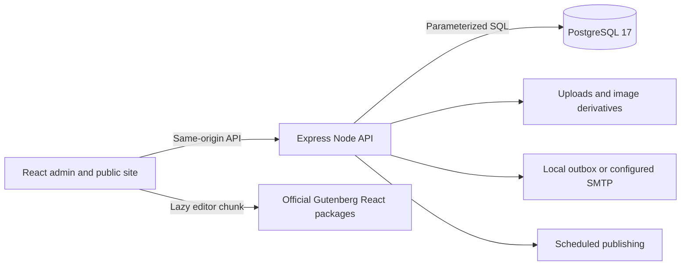

# WorldAct architecture

WorldAct 0.3 is an independent **React + TypeScript → Express + `pg` → PostgreSQL 17** CMS. Its application runtime and build outputs use JavaScript/CSS, with no PHP runtime or MySQL dependency. The supplied WordPress distribution supplies interface references and selected attributed static assets.

## Runtime and modules

Vite serves development at `127.0.0.1:5173` and proxies API, upload, REST, and feed requests to `127.0.0.1:3001`. The compiled Node server serves the built client and backend together. Node 22.13.0+ is required by the current Gutenberg packages. `compose.yaml` defines PostgreSQL `17-alpine`, its health check, loopback port `54329`, and the persistent `worldact_pgdata` volume.

| Source                                                             | Responsibility                                                                            |
| ------------------------------------------------------------------ | ----------------------------------------------------------------------------------------- |
| `src/App.tsx`, `src/components/`                                   | Routing, authenticated admin shell, common controls, media/image UI                       |
| `src/screens/`                                                     | Dashboard, posts/editor, taxonomies, platform settings/design, and public rendering       |
| `src/editor/`                                                      | Lazy official Gutenberg integration, durable block contract, media adapter, site bindings |
| `src/embeds.ts`, `src/publicLinks.ts`, `src/template.ts`           | Video-provider validation, public links and safe template binding                         |
| `server/index.ts`, `server/auth.ts`                                | HTTP application, sessions, login, common middleware and bootstrap                        |
| `server/core.ts`                                                   | Editorial workflows, access rules, taxonomies, revisions/autosaves, locks and scheduler   |
| `server/platform.ts`, `server/design.ts`                           | Profiles/settings, media, menus, site documents, extensions, tools and mail               |
| `server/media-files.ts`, `server/permalinks.ts`, `server/utils.ts` | Derivatives/storage, routing, validation, sanitization and canonical block handling       |
| `server/compat.ts`                                                 | REST compatibility subset, feeds, sitemap/robots, permalink resolver and WXR              |
| `server/blocks.ts`, `server/block-renderer.ts`                       | Native block/entity REST adapters and bounded dynamic public rendering                     |
| `server/accounts.ts`, `server/comments.ts`                          | Registration, confirmed privacy requests and comment editing/moderation                    |
| `server/date.ts`, `server/legacy.ts`                                | Civil-time/UTC conversion and WordPress admin URL redirects                                 |
| `server/*schema.sql`                                               | Repeatable, additive PostgreSQL schema upgrades                                           |

Migration runs atomically under a PostgreSQL advisory lock. Seeds use explicit markers and preserve existing content. `.env`, uploads, dependency directories, and build outputs are excluded from source control as configured by `.gitignore`.

## Editor and content representations

The post editor is loaded through `React.lazy`. It uses the official `@wordpress/block-editor`, `@wordpress/blocks`, `@wordpress/block-library`, components, data, hooks, and format packages. A `BlockEditorProvider` owns an iframe `BlockCanvas`; official insertion, transforms, nested blocks, list view, inspector, toolbar and rich-text formats supply editing behavior. WorldAct provides persistence, history controls/iframe keyboard undo, media selection/uploads, link suggestions and attachment entities.

The editor enables static core blocks including paragraph/heading/list/quote, code/table, image/gallery/cover/media-text, audio/video/file, buttons, groups/columns, separators/spacers, details, HTML and embeds. Dynamic core blocks add Query Loop, post content/metadata/terms, pagination, site identity, navigation, page lists, template parts and synced pattern references. YouTube and Vimeo are the enabled embed providers. A strict URL/ID parser constructs their player URLs; public rendering creates those recognized player iframes without trusting arbitrary HTML or contacting a PHP oEmbed service.

Content has separate durable representations:

- `blocks`: JSONB trees of `{ name, attributes, innerBlocks }`; transient client IDs and selections are omitted and recreated on load.
- `raw_content`: sanitized canonical Gutenberg markup with balanced block comments, for round trips and portability.
- `content`: sanitized public HTML without editor metadata or active scripts.

Block JSON has name, attribute, depth and count limits. It is not rendered by blindly interpolating attributes. The server sanitizes published HTML and vetted inline styles, while preserving supported layout/color/typography/spacing markup. Legacy HTML can be converted through Gutenberg's HTML transforms. Revisions and per-user autosaves preserve canonical content as well as block state.

## Domain and editorial rules

PostgreSQL holds users/sessions, posts/pages, terms and post-term relations, media metadata, comments, settings/preferences, revisions, autosaves, navigation menus, site documents/styles, synced block/navigation entities, extensions, password-reset tokens, privacy requests/expiring exports and mail messages. File bytes and generated image derivatives live separately in `uploads/`.

Posts/pages support `draft`, `pending`, `publish`, `future`, `private`, and `trash`, with publication/scheduling timestamps, page hierarchy/order, featured media, post-format classification metadata, sticky and discussion settings, and optional password protection. The Writing default supplies the format classification/public class; format-specific templates and archives are not implemented. Optimistic versions prevent silently overwriting a concurrent save. Per-user autosaves support recovery; transactional row locks serialize conflicting writes. The in-process scheduler publishes due content while Node is running; it is not a separate always-on job service.

Five roles are enforced server-side: administrator, editor, author, contributor and subscriber. Authors/contributors are restricted to their own posts; contributors cannot publish or upload. Page/term/moderation and administrator-only functions have explicit checks. These implemented rules do not constitute WordPress's entire extensible capability system.

## Site design and extensions

Templates, template parts and patterns are versioned site documents using the same block/HTML contract. Native core-data entities persist reusable blocks, navigation, site identity and referenced template parts. Saving the site editor flushes pending entity edits before saving its document. Legacy WorldAct binding blocks remain compatible and are upgraded for native editing. Unsynced patterns insert copies; synced patterns retain database references so edits affect their uses.

Dynamic public rendering parses canonical block markup, resolves query/post/site/entity context and emits sanitized HTML. It filters nonpublic/password-protected query results, checks preview access, bounds nodes/depth/database queries and rendered output to 8 MiB, and stops cyclic content references. Collection metadata is batched where supported. The same renderer supplies public API, feed and REST content. Legacy template bindings still pass a final structural and URL allowlist, preventing metadata from creating executable attributes or unsafe schemes.

REST publication dates use site-local civil time and separate UTC fields. Conversion accounts for named timezones, explicit offsets and daylight-saving transitions; nonexistent local schedule times are rejected. The official editor date settings use the saved site timezone and display formats.

Global styles store supported colors, text/heading font selections, content width and spacing. Navigation items have stable IDs, parent IDs, labels, URLs and targets; validation rejects cycles and each primary/footer location has one assigned menu. The public site consumes these designs, menus and styles.

Four limited React theme presentations are offered under the Twenty Twenty-Five, Twenty Twenty-Four, Twenty Twenty-Three and WorldAct Classic names. They are not complete executions or ports of the original PHP themes. Manrope and Inter variable fonts are served locally from the supplied themes with their SIL Open Font License notices. Other font choices use system fonts and fallbacks.

The local JavaScript registry implements Reading Time, Spam Shield, Site SEO and Custom Footer. Installation, activation, settings, deactivation and deletion persist in PostgreSQL. Enabled modules affect public metadata/footer/reading time or comment classification. There is no arbitrary ZIP/PHP plugin loader or WordPress.org update service.

## HTTP boundaries

| Boundary         | Implemented routes                                                                                      |
| ---------------- | ------------------------------------------------------------------------------------------------------- |
| Sessions/account | `/api/session`, `/api/auth/*`, `/api/profile`, `/api/preferences`, `/api/users`                         |
| Editorial        | `/api/posts`, post revisions/autosave routes, `/api/terms`, `/api/comments`                             |
| Media            | `/api/media`, image edit/restore routes, `/uploads/*`                                                   |
| Design           | `/api/menus`, `/api/site-editor/*`, `/api/themes`, `/api/plugins`                                       |
| Public           | `/api/public/site`, posts/unlock/comments, `/api/public/design`, `/api/public/resolve`                  |
| Tools            | `/api/tools/health`, mail, export/import and personal-data export                                       |
| Privacy          | `/api/tools/privacy/requests/*`, `/api/privacy/confirm`, private expiring download links                 |
| Compatibility    | `/wp-json/wp/v2` subset for content/media/terms/comments, block renderers/entities, settings and template parts |
| Discovery        | RSS/Atom/comment feeds, sitemap and robots output                                                       |

The REST subset adapts to WorldAct's domain, session authentication and permission checks; it is not complete endpoint/schema/extension compatibility. Legacy `/wp-admin` and `/wp-login.php` paths redirect to React routes and do not execute PHP.

## Storage, portability and limits

Uploads allow supported images, audio/video, PDF and Office documents up to **32 MiB**, with signature/MIME checks and executable/SVG/HTML rejection. Sharp generates configured thumbnail/medium/large sizes and applies crop, rotation, flip, resize and restore. Year/month storage and size settings affect generated files. Existing image URLs are retained as backups during edits until permanent deletion. A backup must cover both PostgreSQL and uploads.

WorldAct JSON import restores content, canonical blocks, synced-pattern/block-navigation entities, terms, hierarchy and comments. Entity import allocates fresh IDs before rewriting nested canonical and JSON references; missing/wrong-kind references are dropped with warnings. The export also carries design/settings/legacy-menu/media references, which the JSON importer does not restore. Password-protected exports and scheduled/protected imports use draft status for review. IDs are remapped and colliding URLs made unique. WXR supports implemented posts/pages/taxonomies/hierarchy/comments, preserves canonical markup, drops unsupported entity references with warnings, and reports skipped remote attachments instead of downloading them. Neither format is a complete site/database/files backup. The UI caps import files at 8 MB; JSON HTTP bodies are capped at 10 MB.

## Authentication and operational safeguards

Passwords use native Node `scrypt` with per-password salts and constant-time comparison. Session/reset tokens are random; only token hashes are stored. Session cookies are HttpOnly/SameSite, with Secure in production. Logout/revocation, other-session logout and password resets invalidate the appropriate sessions. Protected endpoints validate roles, ownership, input sizes/types and same-origin mutations. SQL values are parameterized. Login/comment/reset flows have request limits.

Optional registration uses the configured default role and a single-use password-setting link. Privacy requests use hashed confirmation/download tokens, explicit confirmation, expiring exports and serialized erasure/export operations. Erasure anonymizes comment identities and revokes associated export snapshots, including linked-account aliases; it retains accounts, authored content, comment text and request records. Comment versions and hierarchy locks prevent stale edits and cyclic replies. Account/media deletion locks the current file manifest through deletion so concurrent edits cannot orphan public image files.

Email defaults to a local database outbox. SMTP sends only when configured; failed delivery leaves the message available locally. Runtime credentials remain server-side. These are implemented controls, not a security certification.

At the recorded audit, npm reports 19 low findings originating from the transitive `deepmerge@4.3.1` advisory [GHSA-gcqx-w48m-w2h4](https://github.com/advisories/GHSA-gcqx-w48m-w2h4), with no fixed compatible release available. Forced downgrades of the current Gutenberg package family are not applied.

See [parity and verification](parity.md) for exercised workflows and the remaining ecosystem/visual boundaries.
