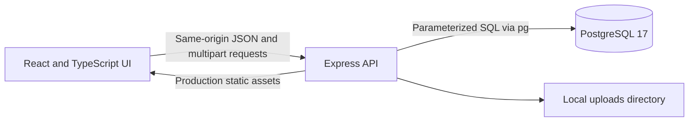

# WorldAct architecture

WorldAct rebuilds selected WordPress workflows using **React + TypeScript → Express + `pg` → PostgreSQL 17**. The implementation must contain no PHP runtime or MySQL dependency. This is an independent application with its own schema and API, using the supplied WordPress distribution as a visual and behavioral reference.

## Implementation status

The first React application, Express API, schema, migration, seed, and PostgreSQL Compose service are implemented. Setup, the API integration suite, TypeScript, and the client/server build pass. Core editor/public workflows have also been exercised in a browser. This is a limited first milestone; see [the parity tracker](parity.md) for exact verification and remaining gaps.

## Runtime shape

Vite supplies the development client at `http://127.0.0.1:5173`. Its proxy forwards `/api` and `/uploads` to Express at `http://127.0.0.1:3001`, so browser requests use the same origin. Express also serves the Vite build together with the API and uploaded media when using the compiled application.

`compose.yaml` currently defines PostgreSQL `17-alpine`, a persistent `worldact_pgdata` volume, a database health check, and a database port bound to loopback at `127.0.0.1:54329`. The application reads its connection string from `DATABASE_URL`; database credentials belong in the environment, not client bundles.

The configured build checks TypeScript, builds the React client with Vite, and bundles the server entry with esbuild. Migration and idempotent seed scripts are implemented and have been run successfully against PostgreSQL. The root README owns runnable setup instructions and verified commands.

## Client

React Router exposes:

- Public `/`, `/posts/:slug`, and `/pages/:slug` views.
- `/login` and the authenticated `/admin` shell.
- `/admin/posts`, `/admin/posts/new`, `/admin/posts/:id`, and equivalent page routes.
- `/admin/media`, `/admin/comments`, `/admin/users`, and `/admin/settings`.

The `/wp-admin` and `/wp-login.php` aliases are redirects only; a legacy-looking URL does not introduce a PHP file or runtime.

The client uses an API helper with same-origin credentials, explicit loading states, and JSON errors shaped as `{ "error": "message" }`. It must not store an authentication bearer token in localStorage. The server remains responsible for validation, permission checks, sanitization, and persistence even when a control is hidden in the UI.

The initial editor stores sanitized HTML and offers a small set of editable blocks. It is not the complete Gutenberg editor. The public site renders published content only. Reference static CSS and assets can reproduce the admin interface while application behavior is implemented in React; copying WordPress's PHP code is unnecessary and outside this design.

## API boundaries

| Boundary       | Intended API                                                                             |
| -------------- | ---------------------------------------------------------------------------------------- |
| Session        | `GET /api/session`; `POST /api/auth/login`; `POST /api/auth/logout`                      |
| Dashboard      | `GET /api/dashboard` with content counts, recent posts, and recent comments              |
| Content        | `GET/POST /api/posts`; `GET/PUT/DELETE /api/posts/:id`; type, status, and search filters |
| Media          | `GET/POST /api/media`; `PUT/DELETE /api/media/:id`; multipart field `file`               |
| Comments       | `GET /api/comments`; `PUT/DELETE /api/comments/:id`                                      |
| Users          | `GET/POST /api/users`; `DELETE /api/users/:id`                                           |
| Settings       | `GET/PUT /api/settings`                                                                  |
| Public content | `GET /api/public/site`; `GET /api/public/posts/:slug`; `POST /api/public/comments`       |

The first-slice post states are `publish`, `draft`, and `trash`; content type is `post` or `page`. Comment states are `approved`, `pending`, `spam`, and `trash`. The supported roles are `administrator`, `editor`, `author`, and `subscriber`. These roles need explicit server-side authorization rather than an assumption that their presence establishes WordPress's complete capability model.

Published public responses must exclude drafts and trash. Public comments require validation and enter moderation as pending. Private administrative endpoints must authenticate before returning protected data or accepting mutations. Permanent deletion is distinct from moving an item to trash.

## Persistence

PostgreSQL is the authoritative store. The intended domain includes users, sessions, posts/pages, media metadata, comments, and site settings. Posts reference an author; comments reference content; media records hold metadata for files in the upload directory. Foreign-key and deletion policies must preserve valid relationships and protect administrative access, including attempts to remove the active user.

Use parameterized SQL through `pg` for user values. Migrations own schema changes, and seeds create explicit study content and an initial administrator. The application must not depend on a WordPress/MySQL database or report success for writes that exist only in browser state. Upload bytes live on the filesystem in this first slice, so a backup must include both the PostgreSQL database and the uploads directory.

Timestamps cross the API as ISO strings and are displayed in the user's local time. Settings include site title, tagline, site URL, administrator email, timezone, date/time formats, posts per page, search-engine discouragement, and a restricted theme identifier.

## Authentication and content safety contract

The server implements the following controls; the API integration tests exercise their primary behavior:

- Hash passwords with Node's native `scrypt`, a per-password random salt, and a constant-time comparison. Store password hashes only; never return them in user JSON.
- Generate unpredictable server sessions, store only a hash of each session token, enforce expiration, and invalidate the session on logout. Deliver the token in an HttpOnly, SameSite cookie, with Secure enabled when served over HTTPS.
- Check roles and resource ownership on the server for protected reads and mutations. Administrative user/settings operations must not rely on client-side route protection.
- Enforce the configured same-site/origin boundary for state-changing requests. A development proxy keeps client requests same-origin; it does not replace request-origin validation or cookie protections.
- Validate input with explicit field/type/length limits before SQL. Treat user HTML as untrusted and sanitize it with an allowlist on the server before storage or rendering.
- Limit uploads by size and allowed formats, validate the actual file content as well as the declared MIME type, generate safe server filenames, and reject executable formats. Serve uploaded content as static files with appropriate content types and browser protections. Do not accept SVG/HTML or arbitrary scripts as trusted images.
- Return useful errors without exposing secrets, session values, password hashes, filesystem internals, or database connection strings.

Uploads are limited to 8 MiB JPEG, PNG, GIF, or WebP files with a matching MIME type and signature. Login and public comments have in-memory request limits. Production sessions set Secure and require an HTTPS deployment. These checks are a first implementation, not a security certification or the full WordPress capability model.

## Reference and compatibility

The supplied `/Users/olegkuftyrev/Desktop/wordpress/wp-includes/version.php` declares WordPress 7.1.4. The reference is an unconfigured distribution, so it cannot establish an installed site's actual content or enabled options. It has not been run as a PHP/MySQL service for this rewrite.

WorldAct's `/api` is not the WordPress REST API. PHP plugins/themes, multisite, complete Gutenberg/site editing, revisions/autosave, scheduled/private publication, taxonomies, installer/updater behavior, feeds, and import/export need separate work. Reusing a theme's name or static assets does not execute its PHP or reproduce every template. [The parity tracker](parity.md) records those limitations.

WordPress reference assets retain their original attribution and license notices; the supplied readme identifies GPL v2 or later. Project license and third-party notices belong at the repository root. Personal use is the intended project context, while the code should still preserve the provenance of copied assets.
