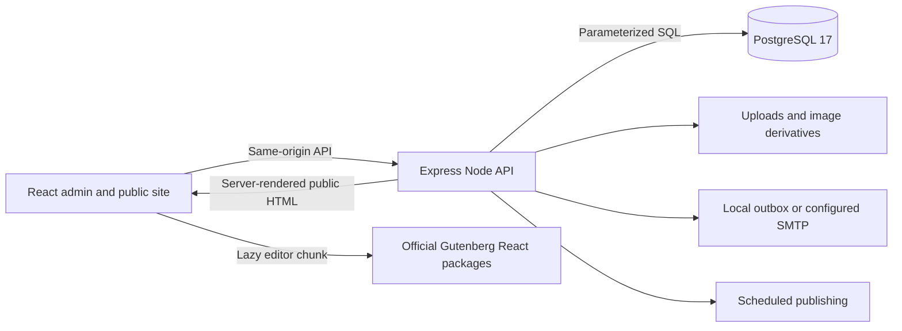

# WorldAct architecture

WorldAct 0.4 is an independent **React + TypeScript → Express + `pg` → PostgreSQL 17** CMS. Its application runtime and build outputs use JavaScript/CSS, with no PHP runtime or MySQL dependency. The supplied WordPress distribution supplies interface references and selected attributed static assets.

## Runtime and modules

Vite serves development at `127.0.0.1:5173` and proxies API, upload, REST, and feed requests to `127.0.0.1:3001`. The compiled Node server serves the built client and backend together. Node 22.13.0+ is required by the current Gutenberg packages. `compose.yaml` defines PostgreSQL `17-alpine`, its health check, loopback port `54329`, and the persistent `worldact_pgdata` volume.

| Source                                                             | Responsibility                                                                            |
| ------------------------------------------------------------------ | ----------------------------------------------------------------------------------------- |
| `src/App.tsx`, `src/components/`                                   | Routing, authenticated admin shell, common controls, media/image UI                       |
| `src/screens/`                                                     | Dashboard, posts/editor, taxonomies, platform settings and design                         |
| `src/public/`, `shared/public-document.ts`                           | Shared Node-safe public view, browser document ownership, hydration and enhancements      |
| `src/editor/`                                                      | Lazy official Gutenberg integration, durable block contract, media adapter, site bindings |
| `src/embeds.ts`, `src/publicLinks.ts`, `src/template.ts`           | Video-provider validation, public links and safe template binding                         |
| `server/index.ts`, `server/auth.ts`                                | HTTP application, sessions, login, common middleware and bootstrap                        |
| `server/core.ts`                                                   | Editorial workflows, access rules, taxonomies, revisions/autosaves, locks and scheduler   |
| `server/public-read.ts`, `server/public-document-data.ts`, `server/render-public-document.tsx` | Direct authorized public reads, presentation models and complete HTML assembly |
| `server/platform.ts`, `server/design.ts`                           | Profiles/settings, media, menus, site documents, extensions, tools and mail               |
| `server/media-files.ts`, `server/permalinks.ts`, `server/utils.ts` | Derivatives/storage, routing, validation, sanitization and canonical block handling       |
| `server/compat.ts`                                                 | REST compatibility subset, feeds, sitemap/robots, permalink resolver and WXR              |
| `server/blocks.ts`, `server/block-renderer.ts`                       | Native block/entity REST adapters and bounded dynamic public rendering                     |
| `server/widget-blocks.ts`, `server/date-archives.ts`                 | Source widget rendering and timezone-safe date archive filtering/grouping                  |
| `server/footnotes.ts`, `server/term-blocks.ts`, `server/post-preview.ts` | Rich note metadata, term-query context and actor/version-scoped autosave previews          |
| `server/accounts.ts`, `server/comments.ts`                          | Registration, confirmed privacy requests and comment editing/moderation                    |
| `server/date.ts`, `server/legacy.ts`                                | Civil-time/UTC conversion and WordPress admin URL redirects                                 |
| `server/site-identity.ts`, `server/post-templates.ts`                | Confirmed administrator email, site icon derivatives and content-type template assignments |
| `server/fonts.ts`, `server/themes.ts`                               | Validated local font storage/activation, source themes and generated typography/CSS        |
| `server/bundled-plugins.ts`                                         | Supplied plugin ports, isolated credentials, opt-in service transport and retained metadata |
| `server/diagnostics.ts`, `server/privacy-policy.ts`                  | Redacted categorized Site Health information and contextual privacy-policy draft guidance |
| `server/*schema.sql`                                               | Repeatable, additive PostgreSQL schema upgrades                                           |

Migration runs atomically under a PostgreSQL advisory lock. Seeds use explicit markers and preserve existing content. `.env`, uploads, dependency directories, and build outputs are excluded from source control as configured by `.gitignore`.

## Public documents

The compiled Node server renders public GET/HEAD documents through a narrow shared React view. It reads the selected immutable post ID/type/publication separately from its body, resolves the actual request cookie and password grant, and projects only public presentation fields into an escaped, single-use JSON model. HTML authentication ignores application-password Basic credentials. Framework/admin/editor routes retain their JavaScript application shell, including the standalone login screen; the full administrative App is never rendered on the server. The same document service supplies `/api/public/document?path=...` for browser navigation and the Vite development client.

Source templates remain opaque sanitized HTML islands; Classic uses the extracted shared JSX. Initial dates, selected body, block-query counters, comment window and eligible Reply context come from the same model. The assembler fills three checked compiler markers and completes all rendering before headers, with a 64 MiB complete-document limit in addition to existing 8 MiB fragment limits. Public documents use actual 200/404 statuses and private no-store headers; failed assembly returns the existing bounded error response.

Every JavaScript-enabled public root waits behind an early compositor/inert gate for one fresh owned model validation. An unchanged model hydrates the existing nodes; a changed model replaces the gated tree. Departed route/account generations cannot reuse pending reads or mutation feedback. Pagehide gates immediately and persisted pageshow requires revalidation. A boot failure has an outside-root retry control whose essential styles ship in the head. With JavaScript genuinely disabled, authorized request-time HTML and native public forms remain available; previously delivered bytes cannot be revoked. This choice adds a validation request before JavaScript-enabled first paint. See [server rendering boundaries](../server/public-document-ssr.md) and [browser ownership](../src/public/README.md).

Native comment/password303 returns validate the current public immutable post/type and reconstruct only recognized local context. Approved comments select the actual chronological saved-comment page; password returns retain positive Reply intent for fresh validation. Separate body and Query Loop counters survive. Independent browser review exercised real pagehide/Back/Forward, but this browser refused BFCache admission and reported persisted:false, so genuine BFCache restoration remains unverified.

## Editor and content representations

The post editor is loaded through `React.lazy`. It uses the official `@wordpress/block-editor`, `@wordpress/blocks`, `@wordpress/block-library`, components, data, hooks, and format packages. A `BlockEditorProvider` owns an iframe `BlockCanvas`; official insertion, transforms, nested blocks, list view, inspector, toolbar and rich-text formats supply editing behavior. WorldAct provides persistence, history controls/iframe keyboard undo, media selection/uploads, link suggestions and attachment entities.

The editor enables static core blocks including paragraph/heading/list/quote, code/table, image/gallery/cover/media-text, audio/video/file, buttons, groups/columns, separators/spacers, details, HTML and embeds. Dynamic core blocks add Query Loop, post content/metadata/terms, pagination, site identity, navigation, page lists, template parts and synced pattern references. YouTube and Vimeo are the enabled embed providers. A strict URL/ID parser constructs their player URLs; public rendering creates those recognized player iframes without trusting arbitrary HTML or contacting a PHP oEmbed service.

Content has separate durable representations:

- `blocks`: JSONB trees of `{ name, attributes, innerBlocks }`; transient client IDs and selections are omitted and recreated on load.
- `raw_content`: sanitized canonical Gutenberg markup with balanced block comments, for round trips and portability.
- `content`: sanitized public HTML without editor metadata or active scripts.

Block JSON has name, attribute, depth and count limits. It is not rendered by blindly interpolating attributes. The server sanitizes published HTML and vetted inline styles, while preserving supported layout/color/typography/spacing markup. Legacy HTML can be converted through Gutenberg's HTML transforms. Revisions and per-user autosaves preserve canonical content as well as block state.

Footnotes use a bounded JSONB metadata array (500 notes, 20 KB per note, 1 MB including the complete JSON envelope). The native REST adapter exposes the source JSON-string `meta.footnotes` contract. Rich content is sanitized, and only footnote `sup` elements retain validated `data-fn` references. The editor synchronizes reference order, numbering, metadata and block history together, including a bounded deleted-note cache for Undo. Save/autosave/recovery/revisions carry content and notes atomically. Authorized previews overlay only the requesting actor's autosave with the current saved version; public responses retain saved content and omit locked metadata. Automatic excerpts omit reference markers and the note list. JSON/WXR copies allocate fresh fragment IDs, remapping only local/self links while preserving unrelated URLs.

Editable footnote controls require the exact post ID/type owned by that editor's atomic save transaction. Footnotes can also be placed in site templates and queried-post contexts, where they show a read-only preview of that post's notes; edit those notes in its post/page editor. This avoids making an unsaved template edit independently change a queried post.

## Domain and editorial rules

PostgreSQL holds users/sessions, posts/pages, terms and post-term relations, media metadata, comments, settings/preferences, revisions, autosaves, navigation menus, site documents/styles, synced block/navigation entities, extensions, password-reset tokens, privacy requests/expiring exports and mail messages. File bytes and generated image derivatives live separately in `uploads/`.

Posts/pages support `draft`, `pending`, `publish`, `future`, `private`, and `trash`, with publication/scheduling timestamps, page hierarchy/order, featured media, post-format classification metadata, sticky and discussion settings, and optional password protection. The Writing default supplies the format classification/public class; format-specific templates and archives are not implemented. 150-second editor leases renew through heartbeat and require an explicit takeover before another editor can save. Optimistic versions prevent silently overwriting a concurrent save. Per-user autosaves support recovery; transactional row locks serialize conflicting writes. The in-process scheduler publishes due content while Node is running; it is not a separate always-on job service.

Named application passwords are displayed once and stored as SHA-256 digests of high-entropy keys. HTTP Basic application-password requests support API clients without a browser Origin; foreign origins remain rejected, account-password Basic authentication is rejected, and revocation is immediate.

Five roles are enforced server-side: administrator, editor, author, contributor and subscriber. Authors/contributors are restricted to their own posts; contributors cannot publish or upload. Page/term/moderation and administrator-only functions have explicit checks. These implemented rules do not constitute WordPress's entire extensible capability system.

## Site design and extensions

Templates, template parts and patterns are versioned site documents using the same block/HTML contract. Native core-data entities persist reusable blocks, navigation, site identity and referenced template parts. Saving the site editor flushes pending entity edits before saving its document. Legacy WorldAct binding blocks remain compatible and are upgraded for native editing. Unsynced patterns insert copies; synced patterns retain database references so edits affect their uses.

Template-part APIs persist the source areas `uncategorized`, `header`, `footer` and `navigation-overlay`. Trusted source metadata records the original title and area as well as content. Clearing customizations restores all three under a document-row lock; title-only or area-only edits count as customizations. Renaming a source document or changing its type detaches its old source provenance. JSON copies retain valid areas and remap navigation overlay references to imported parts.

Dynamic public rendering parses canonical block markup, resolves query/post/site/entity context and emits sanitized HTML. It filters nonpublic/password-protected query results, checks preview access, bounds nodes/depth/database queries and rendered output to 8 MiB, and stops cyclic content references. Collection metadata is batched where supported. The same renderer supplies public API, feed and REST content. Legacy template bindings still pass a final structural and URL allowlist, preventing metadata from creating executable attributes or unsafe schemes.

Native Accordion/Tabs render their official structural classes and source attributes with generated local ARIA pairs. IDs share a deterministic document namespace and per-render reservation set. The public React hook initializes only fixed WorldAct selectors, handles manual tab activation, accordion defaults and hash/beforematch opening, then restores readable fallback content and removes listeners on cleanup. Saved Interactivity API expressions are never evaluated. The editor omits schema attributes whose official role is `local` when serializing durable content. Background support encodes bounded HTTP(S)/local media URLs, validates image/gradient layers and source sizing defaults, and preserves image paths during archive remapping, including entity-quoted CSS.

REST publication dates use site-local civil time and separate UTC fields. Conversion accounts for named timezones, explicit offsets and daylight-saving transitions; nonexistent local schedule times are rejected. Signed offset aliases normalize at settings validation/read boundaries. The official editor date settings use the saved site timezone and display formats. Public year/month/day/week archives, Calendar and Archives widgets share local-date grouping and half-open publication bounds; skipped civil dates select no posts. UTC SQL bounds preserve PostgreSQL's extended-year/BC notation independently of the host timezone. Native REST author/media embeds provide public profile fields and real image-size URLs for editor previews.

Term Query/Template provide a nested term context for names, counts and descriptions, with source hierarchy, empty-ancestor and explicit-order behavior. Native category/tag collection queries share the same bounded filtering and pagination. Breadcrumbs resolve public ancestors, archive context and pagination; cycles and private ancestors stop traversal. The Login/Out form and JSON login share password verification, session rotation and one IP attempt limit. Native form returns pass the same local URL validator used by the React login screen; Remember Me selects a persistent 14-day session versus a 2-day browser session, while omitted API preferences preserve the existing 7-day default.

Login verifies the submitted password before acquiring locks, then locks the current user for sharing and rechecks the exact password hash before rotating/creating a session in that transaction. It returns the current account fields and issues the cookie after commit. Password reset first checks the candidate token before performing scrypt, then locks the user for update, revalidates/consumes the token and revokes all sessions/reset tokens atomically. Reset requests serialize token replacement and outbox insertion under the same user-first order, and deliver mail after commit. Global expired-row cleanup holds no user lock.

Global styles store supported colors, text/heading font selections, content width and spacing. Navigation items have stable IDs, parent IDs, labels, URLs and targets; validation rejects cycles and each primary/footer location has one assigned menu. The public site consumes these designs, menus and styles.

The supplied Twenty Twenty-Five, Twenty Twenty-Four and Twenty Twenty-Three block themes are statically imported into a checked manifest: 28 templates, 15 parts, 164 patterns and 25 full-theme variations. A constrained importer treats known PHP translation wrappers as text; it does not execute PHP. Two canonical WordPress.org directory patterns declared by Twenty Twenty-Four are checked in with provenance, so runtime rendering does not need that directory. Theme fonts, image assets, CSS and licenses ship locally. The compiler resolves theme.json palettes, fonts, layout and style variations into scoped CSS. Source documents are keyed by `(theme,type,slug)`; migration updates untouched originals while preserving edits, and reset uses the trusted bundled manifest. Per-theme variations and style overrides survive activation changes. A legacy Classic presentation remains separate.

The local JavaScript registry implements Reading Time, Spam Shield, Site SEO and Custom Footer, plus Node ports of the supplied Hello Dolly and Akismet plugins. Installation, activation, settings, deactivation and deletion persist in PostgreSQL. Hello Dolly displays an attributed administration lyric. Akismet runs only after explicit processing opt-in, a configured API key and verification of the current site URL. Fixed HTTPS endpoints, timeouts and response limits bound service requests; unavailable configured checks hold comments for moderation. Tests mock external service transport. Credentials live in a separate nonexported table, never general extension settings; admin DTOs show only a masked suffix. Retained submission metadata expires after 30 days, with scheduled cleanup and scoped privacy export/erasure. There is no arbitrary ZIP/PHP plugin loader or WordPress.org update service.

Font Library validates TTF/OTF/WOFF/WOFF2 signatures, expanded table sizes and parsed metadata with time/memory limits. Local uploads are limited to 8 MiB per face. Families and faces activate per theme; selected typography reaches both editor iframes and public styles. JSON archives embed validated font bytes, allocate fresh IDs/files, and remap font aliases/presets when names collide.

Administration-email changes retain the old contact until a 24-hour, hashed, single-use confirmation token is explicitly submitted. Site-icon cropping creates a separate 512-pixel asset and the actual configured derivative sizes, preserving the original upload. General date/time/week-start settings feed the editor's official date package. Site Health Info excludes credentials, tokens, mail bodies, recipient addresses and absolute local paths; privacy guidance creates a private draft for review.

## HTTP boundaries

| Boundary         | Implemented routes                                                                                      |
| ---------------- | ------------------------------------------------------------------------------------------------------- |
| Sessions/account | `/api/session`, `/api/auth/*`, `/api/profile`, `/api/preferences`, `/api/users`                         |
| Editorial        | `/api/posts`, post revisions/autosave routes, `/api/terms`, `/api/comments`                             |
| Media            | `/api/media`, image edit/restore routes, `/uploads/*`                                                   |
| Design           | `/api/menus`, `/api/site-editor/*`, `/api/themes`, `/api/plugins`                                       |
| Public           | `/api/public/document`, `/api/public/site`, posts/unlock/comments, `/api/public/design`, `/api/public/resolve` |
| Tools            | `/api/tools/health`, mail, export/import and personal-data export                                       |
| Privacy          | `/api/tools/privacy/requests/*`, `/api/privacy/confirm`, private expiring download links                 |
| Compatibility    | `/wp-json/wp/v2` subset for content/media/terms/comments, block renderers/entities, settings and template parts |
| Discovery        | RSS/Atom/comment feeds, sitemap and robots output                                                       |

The REST subset adapts to WorldAct's domain, session authentication and permission checks; it is not complete endpoint/schema/extension compatibility. Legacy `/wp-admin` and `/wp-login.php` paths redirect to React routes and do not execute PHP.

## Storage, portability and limits

Uploads allow supported images, audio/video, PDF and Office documents up to **32 MiB**, with signature/MIME checks and executable/SVG/HTML rejection. Sharp generates configured thumbnail/medium/large sizes and applies crop, rotation, flip, resize and restore. Year/month storage and size settings affect generated files. Existing image URLs are retained as backups during edits until permanent deletion. A backup must cover both PostgreSQL and uploads.

JSON v3 exports include self-contained upload bytes and image history, design documents, per-theme variations, menus, settings and extension configuration alongside content. Imports allocate IDs and filenames before remapping nested block/entity/document/media/post/term/author references and local URLs. Default copy mode preserves the live design; explicit replace mode activates imported supported settings/design while retaining destination contact/URL. File staging checks signatures/MIME, SHA-256, safe paths and decoded sizes; transactions remove staged files on failure. Imported provenance never designates trusted originals. Media attachments map to destination posts and missing targets detach with warnings.

The archive limit is 96 MiB JSON with 32 MiB per media file, 8 MiB per font and 64 MiB combined decoded bytes. WXR remains 8 MB, uses a shared exported post/entity ID namespace, supports synced patterns/navigation/template assignments, and warns instead of fetching remote attachments. Account/session/Akismet secrets are excluded, and protected/scheduled imports become drafts. Preserve PostgreSQL and uploads separately for complete backups.

## Authentication and operational safeguards

Screen preferences merge per screen and field without replacing unrelated preferences. Media tables use real SQL filtering/paging; attach/detach checks content ownership and foreign keys clear attachment relationships on deletion. Discussion rules and email queuing commit with the comment; only then does optional SMTP run. Consent cookies carry opaque tokens whose hashes reference comments, so erasure/deletion also removes recalled personal details. Avatar URLs follow the supplied source’s SHA-256 Gravatar format and rating/default settings.

Passwords use native Node `scrypt` with per-password salts and constant-time comparison. Session/reset tokens are random; only token hashes are stored. Session cookies are HttpOnly/SameSite, with Secure in production. Logout/revocation, other-session logout and password resets invalidate the appropriate sessions. Protected endpoints validate roles, ownership, input sizes/types and same-origin mutations. SQL values are parameterized. Login/comment/reset flows have request limits.

Optional registration uses the configured default role and a single-use password-setting link. Privacy requests use hashed confirmation/download tokens, explicit confirmation, expiring exports and serialized erasure/export operations. Erasure anonymizes comment identities and revokes associated export snapshots, including linked-account aliases; it retains accounts, authored content, comment text and request records. Comment versions and hierarchy locks prevent stale edits and cyclic replies. Account/media deletion locks the current file manifest through deletion so concurrent edits cannot orphan public image files.

Email defaults to a local database outbox. SMTP sends only when configured; failed delivery leaves the message available locally. Runtime credentials remain server-side. These are implemented controls, not a security certification.

At the recorded audit, npm reports 19 low findings originating from the transitive `deepmerge@4.3.1` advisory [GHSA-gcqx-w48m-w2h4](https://github.com/advisories/GHSA-gcqx-w48m-w2h4), with no fixed compatible release available. Forced downgrades of the current Gutenberg package family are not applied.

See [parity and verification](parity.md) for exercised workflows and the remaining ecosystem/visual boundaries.
